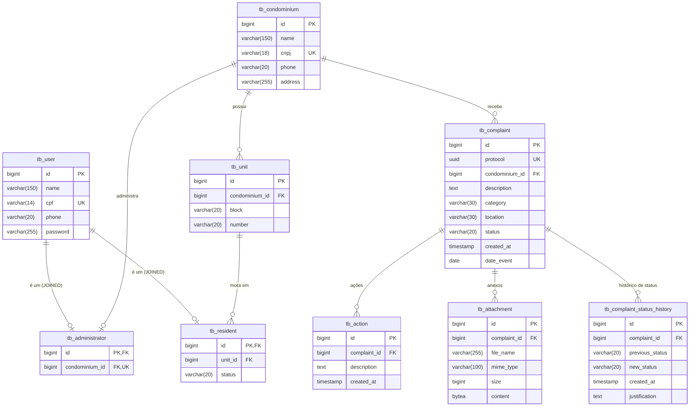

# Sistema de Condomínio: diagrama relacional (PostgreSQL)

Banco `db_condominio`, tabelas com prefixo `tb_`, colunas em `snake_case`. Scripts em `db/01_create_database.sql` e `db/02_create_tables.sql`.

## Decisões do modelo

- **Herança de `User`:** `tb_administrator` e `tb_resident` usam como PK o próprio `id` de `tb_user` (FK com `ON DELETE CASCADE`), que é o mapeamento `@Inheritance(strategy = JOINED)`. Só `tb_user` gera o ID.
- **Anonimato:** `tb_complaint` não tem coluna ligada a usuário.
- **Condomínio único (MVP):** o índice `uq_tb_condominium_single` impede uma segunda linha em `tb_condominium`. Para vários condomínios, remova esse índice.
- **Enums:** colunas `VARCHAR` com `CHECK`, usadas com `@Enumerated(EnumType.STRING)`.
- **`protocol`:** `UUID` único; o `ComplaintTrackingDTO` do morador é buscado por ele.
- **Histórico:** `previous_status` é `NULL` no registro inicial; o `CHECK` exige `justification` não vazia quando `new_status = 'REJECTED'` (a mesma regra do service, reforçada no banco).
- **Exclusão em cascata:** ações, anexos e histórico são apagados junto com a denúncia (`orphanRemoval` no JPA).

## Ajustes no JPA

- `@Table(name = "tb_complaint")` etc. em cada entidade, ou `spring.jpa.hibernate.naming.physical-strategy` padrão do Spring Boot, que já converte `dateEvent` em `date_event`.
- `Attachment.content`: no PostgreSQL, `@Lob byte[]` vira `oid` no Hibernate 6. Para usar `BYTEA`, tire o `@Lob` e anote o campo com `@JdbcTypeCode(SqlTypes.VARBINARY)`.
- Com o schema criado pelos scripts, use `spring.jpa.hibernate.ddl-auto=validate`.
