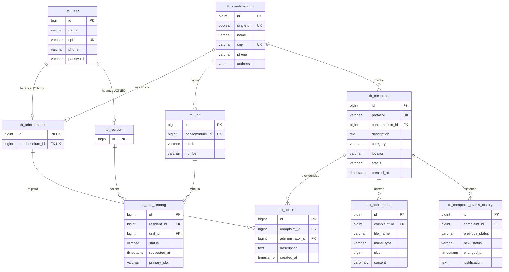

# Gestão de Condomínio — modelo relacional do MVP (H2)

O MVP atende **um condomínio e um síndico**. O modelo abaixo corresponde às entidades JPA; o esquema é gerado pelo Hibernate no H2. Não depende de scripts PostgreSQL.



## Restrições de integridade

- `singleton` é obrigatório, único e deve ser `true`: impede uma segunda linha de condomínio. O setup deverá criar condomínio e síndico atomicamente; um banco vazio é permitido antes do setup.
- `Administrator.condominium` permanece `@OneToOne`, obrigatório e único. Não há vínculo administrativo com múltiplos condomínios.
- `User` usa herança JOINED; CPF é único quando informado. As subclasses compartilham a PK de usuário.
- Unidade é única pela combinação `(condominium_id, block, number)`. Bloco omitido é normalizado para string vazia, evitando duplicidade por NULL; continua opcional para o consumidor da API.
- `UnitBinding` representa a solicitação/vínculo entre morador e unidade. Status: `PENDING`, `APPROVED`, `REJECTED`, `BLOCKED`. O par `(resident_id, unit_id)` é único; uma nova tentativa deve atualizar o vínculo existente, conforme futura política do serviço.
- Responsável aprovado tem `primary_slot = 'PRIMARY'`; demais vínculos usam NULL. A unicidade de `(unit_id, primary_slot)` permite vários moradores adicionais e no máximo um responsável por unidade. CHECK impede responsável sem aprovação. Ao rejeitar/bloquear um responsável, o serviço deverá remover a indicação na mesma operação.
- A escolha do primeiro solicitante e a aprovação pelo síndico serão implementadas nos serviços de K06/K16; o mapeamento não autoriza requisições HTTP.
- Denúncia não possui FK para usuário, morador, unidade ou vínculo. Protocolo é String UUID aleatório, obrigatório, único e imutável no mapeamento; gerado antes da primeira persistência quando omitido. Nova denúncia obrigatoriamente inicia em `RECEIVED`.
- Categoria e status são enums persistidos como texto; descrição/categoria obrigatórias e local opcional. As transições e o salvamento atômico de status/histórico são responsabilidade de K10.
- Histórico admite `previous_status` NULL para o evento inicial. Rejeição exige justificativa não vazia também por CHECK no banco.
- Anexo armazena bytes em VARBINARY com MIME e tamanho. O tamanho é calculado dos bytes ao salvar e conferido por CHECK. Validação de formato real, limites de upload e remoção de metadados pertencem a K14.
- Histórico, ações e anexos usam FKs obrigatórias; não há exclusão em cascata automática das evidências.

## Consultas e testes

Os repositórios oferecem consultas por condomínio e por denúncia/anexo. No cenário de condomínio único, os testes verificam que IDs de contexto incorretos não retornam dados e que um anexo de outra denúncia não é retornado. Isso não substitui autorização por perfil na futura camada de serviços/security (K04).

`DomainPersistenceTests` cobre restrições, responsável único, anonimato estrutural e recuperação de bytes. Cada teste executa com rollback e dados H2. O teste `contextLoads` também valida a carga inicial. Execute com JDK compatível com Java 25:

```bash
./mvnw test
```

PostgreSQL e migrações continuam opcionais em K21; os tipos binários e constraints deverão ser validados no banco escolhido antes de habilitá-lo.
